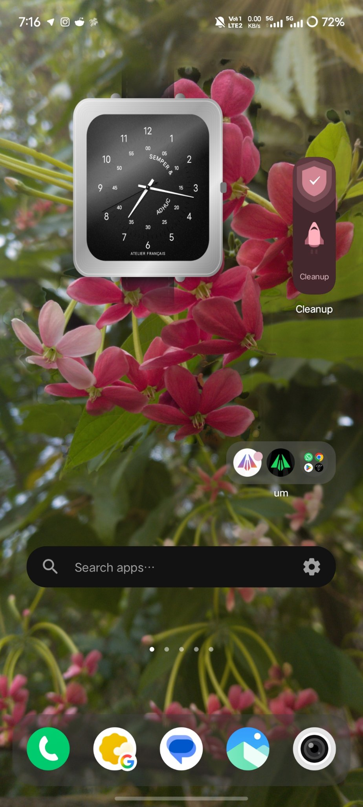
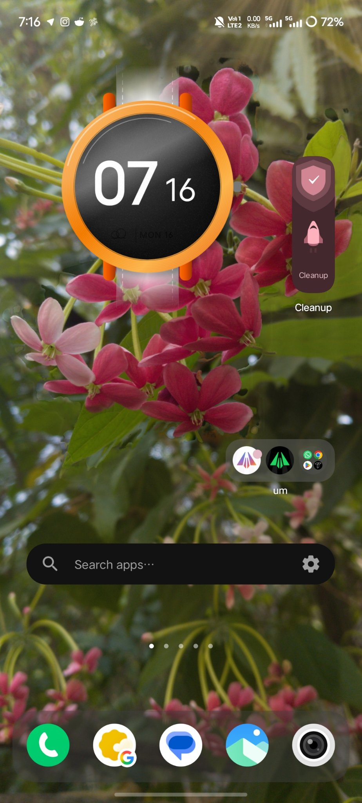
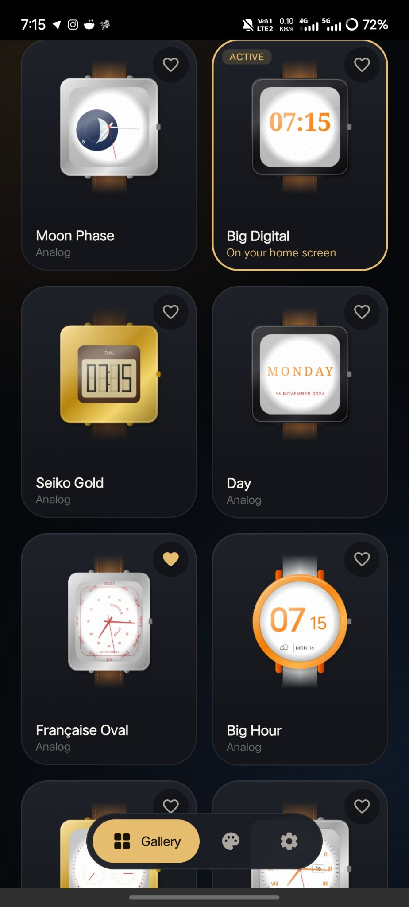
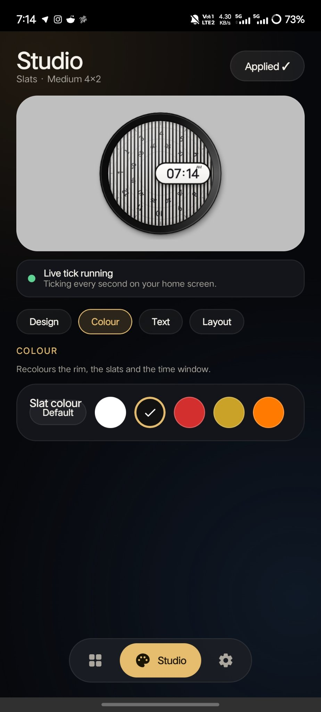
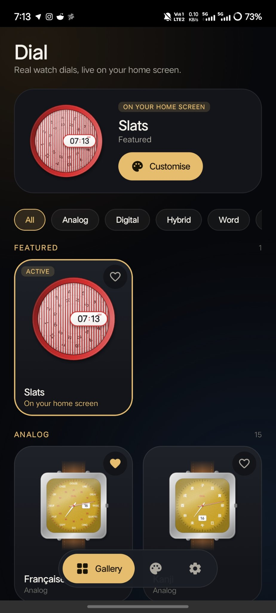

# Clock Widget

Android home-screen widget app with realistic watch dials. Pick a dial, put it on your home screen — the widget ticks every minute, with a live second hand on analog dials.

## Screenshots

<table>
<tr>
<td></td>
<td></td>
<td></td>
</tr>
<tr>
<td></td>
<td></td>
</tr>
</table>

## What it has

- **Realistic watch dials** — each keeps its own case shape from its photo (round stays round, squircle stays squircle), all the same size
- **Digital** — one digital dial, "Black"; **Hybrid** — one hybrid clock, "Hybrid Square" (analog disc and digital time in separate zones that never overlap); **word clocks** with glowing letters
- **Studio** — customise the kept dials: 10 fonts with a weight slider, face styles (Glass / Translucent / Adaptive / Normal), digital layout (one row or stacked), show/hide colon and time size, hybrid position and size sliders, colours (swatches, colour wheel, From photo)
- **Slats** — featured slat clock: shaded vertical slats over rotating number rings, lacquered rim, white capsule window with the time. Recolour it from the Studio
- **In-app updates** — on open, the app checks GitHub releases and offers new versions to download and install without leaving the app
- **Live second tick** on analog dials (needs unrestricted battery permission)
- **Responsive sizing**, date window on all analog dials, word clocks with glowing letters
- Tap the widget only opens the app — dials change inside the app

## Widget stays on time

v2.2 fixed a frozen-clock bug: the widget now re-renders every minute through two independent paths (a minute alarm plus a foreground tick service), and opening the app repairs a stalled update chain. Needs unrestricted battery + exact alarms for the most reliable ticking.

v2.3 added a soft frosted-glass look to the digital and hybrid widget backgrounds: each style keeps its own background colour at ~60% opacity, so the home-screen wallpaper faintly shows through, with a soft top light and a bright rim. Analog dials are unchanged.

v2.4 cut the Digital section from 38 dials to the 19 most distinct ones, removed the Device, Battery, Calendar and Quick-tools widgets, added the featured Slats clock (red slats over rotating number rings), and added in-app update checks: when a new release is published here, opening the app offers it to download and install without leaving the app.

## Build

Open in Android Studio (minSdk 26, targetSdk 33, compileSdk 37) or build with Gradle. Internet is used only to check GitHub releases for app updates; no accounts, no data leaves the phone otherwise.

v3.3 — the Slats capsule now always shows the seconds, small, next to the minutes (05:40:23), ticking every second with the live tick.

v3.4 — Klokers KLOK-01 dial added to Featured.

v3.5 — Klokers fixes: orange locked so Studio colours can't recolour it, minute numbers every 5 minutes, inner SECOND ring with fine ticks and a SECOND label, bigger orange centre disc, longer top marker, orange triangle at 3 o'clock, grey fabric strap.

v3.6 — slimmer dial body.

v3.7 — case lugs removed from every dial (strap band stays).

v3.8 — kept only 1 digital ("Black") and 1 hybrid ("Hybrid Square"); the other 18 digital styles, 6 hybrid styles, Classic Seiko Gold digital and the "Sunset" Studio preset were removed. Word clocks kept. Studio rebuilt: 10 fonts with weight slider, face styles, digital layout/colon/time size, hybrid position and size sliders, Reset customisation, 13 colour swatches + colour wheel + From photo.

v3.2 — fixes: a White colour picked in the Studio was ignored on Apply (white is -1, the old "none" marker); the Slats minute ring showed 00 instead of 60; wallpaper detection failed on phones that return hardware bitmaps; the Studio preview could crash while swapping frames; system Back now returns to the gallery. New: a redesigned app (bottom navigation, gallery filters, tabbed Studio), nicer Slats with Studio colour control, and half of the digital designs moved into the Studio.
